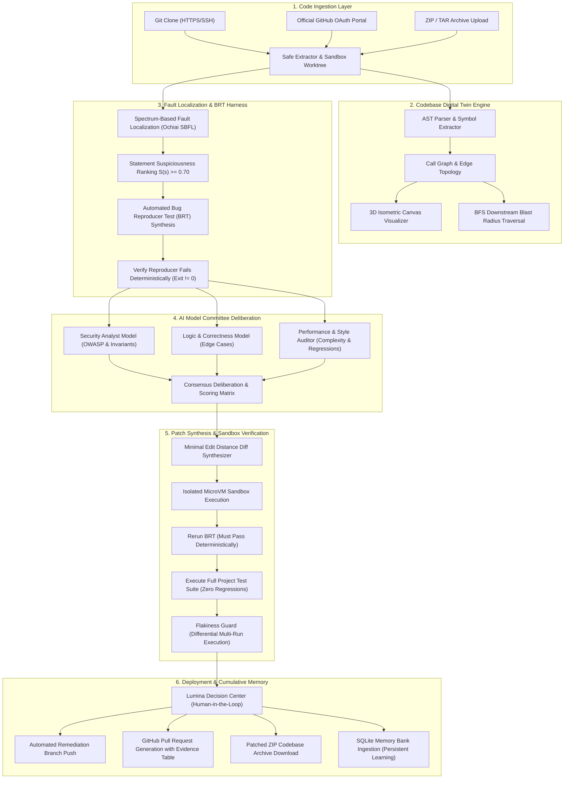
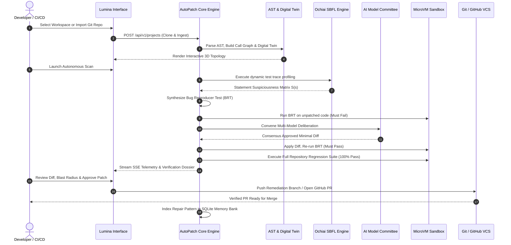

# AutoPatch: Enterprise Architecture, Specification & Technical Whitepaper

> **Platform Version:** v2.4 Enterprise Edition (Lumina Glassmorphic Architecture)  
> **Document Classification:** Confidential / Enterprise Technical Specification  
> **Author:** AutoPatch Core Engineering Team & Lumina Architecture Group  
> **Date:** November 2026  
> **Document File:** [`docs/AutoPatch_Enterprise_Architecture_and_Specification.docx`](file:///Users/niharchavan/Downloads/AntoPatch/docs/AutoPatch_Enterprise_Architecture_and_Specification.docx)

---

## 1. Executive Summary & Core Mission

### The Enterprise Software Crisis
Modern engineering organizations face a systemic dilemma: code production velocity outstrips human verification and maintenance capabilities. Enterprise codebases accumulate technical debt, fragile architectural couplings, and vulnerability backlogs. Traditional approaches rely on reactive human code reviews and periodic security sprints, resulting in high Mean Time to Remediation (MTTR) and developer fatigue.

### The Failure of Generative AI in Production Software
First-generation AI coding tools (e.g., GitHub Copilot, Cursor, raw LLM completions) operate on statistical token probability rather than semantic correctness. When tasked with fixing bugs:
1. **Hallucination Risk:** They invent non-existent APIs, methods, and configurations.
2. **Superficial Patching:** They mask symptoms (e.g., wrapping code in broad `try-catch` blocks) without resolving root invariants.
3. **Cascading Regressions:** They lack whole-repository architectural awareness, silently breaking downstream callers.
4. **Absence of Proof:** They generate code without proving that the bug existed or that the patch resolved it.

### The AutoPatch Invariant Mandate
AutoPatch replaces probabilistic guesswork with **mathematically verified autonomy**:
* **The Reproducer-First Mandate:** No patch is ever applied without first synthesizing an independent Bug Reproducer Test (BRT) that fails deterministically on the unpatched codebase.
* **Deterministic Fault Localization:** Precise line-level fault identification using Spectrum-Based Fault Localization (Ochiai SBFL) and dynamic trace profiling.
* **Adversarial Committee Consensus:** Multi-model debate (Gemini 1.5 Pro, Claude 3.5 Sonnet, GPT-4o ensemble) evaluating candidate diffs across security, logic, and performance invariants.
* **MicroVM Sandbox Verification:** Automated execution of the entire test suite in isolated sandboxes to guarantee zero regressions.

---

## 2. How Everything Works: System Architecture

AutoPatch is structured as a dual-engine architecture: a high-throughput, deterministic FastAPI backend intelligence engine coupled with Lumina, a warm luxury glassmorphic executive interface streaming real-time telemetry over Server-Sent Events (SSE).

### High-Level Architectural Diagram



### Multi-Tenant Security & Secret Redaction
* **Authentication & RBAC:** All endpoints enforce Bearer token authentication or API keys via `get_current_user`. Role-Based Access Control separates `developer`, `admin`, and `auditor` capabilities.
* **Workspace Isolation:** Project directories are sandboxed in isolated `/var/folders/` directories with unique UUIDs. Cross-account access attempts are strictly blocked with HTTP 403 (`assert_project_ownership`).
* **Secret Scrubbing:** Automated regex and Shannon entropy scrubbers scrub API keys, private tokens, and passwords prior to any LLM prompt synthesis or UI event broadcast.

---

## 3. Comprehensive Feature List

AutoPatch delivers a unified suite of enterprise software engineering capabilities organized across the Lumina interface:

| # | Feature Module | Technical Scope & Implementation |
|---|---|---|
| **1** | **Codebase Digital Twin (3D)** | Interactive 3D dependency model mapping functions, APIs, modules, and tests. Provides real-time Breadth-First Search (BFS) blast radius calculation before patch deployment. |
| **2** | **AI Model Committee** | Adversarial multi-agent consensus deliberation. Specialized LLM personas debate candidate patch safety, code invariants, and consensus agreement scores. |
| **3** | **Predictive Bug Detection** | Static AST hazard radar proactively identifying structural failures (mutable default arguments, resource leaks, unhandled exceptions) with calculated failure probabilities. |
| **4** | **Code Hotspot Detection** | Correlates static McCabe cyclomatic complexity with live Git commit churn and unique author counts to pinpoint regression-prone modules. |
| **5** | **Long-Term Repair Learning** | Persistent SQLite Memory Bank indexing verified repair diffs, CWE classifications, and reuse counters to accelerate future patch generation. |
| **6** | **API Security Testing (OWASP)** | AST-driven security audit of REST endpoints (FastAPI, Flask, Express) against OWASP API Security Top 10 vulnerabilities. |
| **7** | **Bug Origin Detection (Git Blame)** | Automated Git blame correlation identifying the exact root-cause commit, commit hash, author identity, and commit summary that introduced the defect. |
| **8** | **Automatic Documentation** | Generates Architecture Decision Records (ADRs), Security Changelogs, and Executive Briefings directly from live scan findings with one-click Markdown copy and download. |
| **9** | **Spectrum-Based Fault Localization** | Mathematical statement-level suspiciousness scoring using the Ochiai ranking metric across dynamic test execution traces. |
| **10** | **Bug Reproducer Test (BRT) Synthesis** | Synthesizes standalone, self-contained reproducer test cases that confirm bugs deterministically prior to patch synthesis. |
| **11** | **MicroVM Sandbox Verifier** | Subprocess execution harness with frozen dependencies, strict wall-clock timeouts, disabled external networking, and differential regression checks. |
| **12** | **Automated Git Remediations** | Automated branch pushing, fork routing on write permission denials, GitHub Pull Request generation with verification evidence tables, and patched ZIP downloads. |
| **13** | **Real-Time Telemetry & Telemetry Ledger** | Live Server-Sent Events (SSE) streaming engine status, scan milestones, and execution logs into the Lumina terminal console. |

---

## 4. Unique Solution: The AutoPatch Value Proposition

AutoPatch redefines autonomous code repair through five architectural pillars:

### 1. The Reproducer-First Mandate
Generic AI assistants generate patches without knowing if a bug actually exists. AutoPatch enforces that every defect must first be reproduced via a dedicated Bug Reproducer Test (BRT). If the test does not fail deterministically on the unpatched codebase, the finding is dropped as a false positive.

### 2. Multi-Model Adversarial Deliberation
Single LLMs exhibit bias, prompt drift, and sycophancy. AutoPatch convenes a 3-agent committee (Security Analyst, Logic Specialist, Performance Auditor) that reviews candidate diffs, highlights edge cases, and votes on consensus.

### 3. Pre-Patch Digital Twin Blast Radius
Before modifying any code, AutoPatch builds a complete AST symbol graph. Engineers visualize downstream callers, public APIs, and test suites affected by the patch, eliminating unexpected ripple effects.

### 4. Deterministic MicroVM Sandbox Verification
Patches are applied and verified in isolated microVM subprocesses. The BRT must pass, and the entire project test suite must pass with 100% stability. Non-deterministic flakiness filters ensure results are reliable.

### 5. Cumulative Memory Bank with Zero Re-Learning
AutoPatch stores verified patch diffs, AST representations, and CWE patterns in SQLite. When similar bugs occur across other microservices, learned templates accelerate synthesis.

---

## 5. Competitor Comparison Matrix

| Capability / Evaluation Vector | AutoPatch | Static Analysis (SonarQube) | Dependency Bots (Snyk/Dependabot) | Coding Assistants (Copilot/Cursor) | Autonomous Agents (Devin/SWE-Agent) |
|---|---|---|---|---|---|
| **Autonomous Bug Repair** | **Yes (Verified Sandbox)** | No (Alerts only) | Partial (Version bumps) | No (Manual prompting) | Yes (High failure rate) |
| **Bug Reproducer Synthesis** | **Yes (Mandatory BRT)** | No | No | No | Rare / Inconsistent |
| **Zero-Regression Guarantee** | **Yes (Full suite execution)** | No | No | No | Flaky / Unpredictable |
| **Multi-Model Consensus** | **Yes (3-Model Committee)** | No | No | No | No (Single LLM loop) |
| **3D Digital Twin Blast Radius** | **Yes (AST Caller Graph)** | No | No | No | No |
| **OWASP API Security Audit** | **Yes (AST Route Audit)** | Partial (Pattern regex) | Dependencies only | No | No |
| **Predictive Hazard Radar** | **Yes (Static AST Analysis)** | Lint rules only | No | No | No |
| **Persistent Repair Memory** | **Yes (SQLite WAL Bank)** | No | No | No | No |
| **Speed & Token Determinism** | **Instant & Controlled** | Fast (Static) | Fast | Interactive | Extremely High Token Burn |

---

## 6. End-to-End Workflow & Pipeline Execution



---

## 7. Complete Technology Stack

* **Backend Core Framework:** Python 3.9+, FastAPI, Uvicorn, Pydantic v2 (REST API, request validation, SSE streaming).
* **AST Parsing & Static Analysis:** Python standard library `ast`, `symtable`, `tokenize` (Symbol extraction, cyclomatic complexity, taint tracking).
* **Fault Localization:** Ochiai Spectrum-Based Fault Localization (SBFL) execution matrix.
* **Sandbox Verification:** Subprocess MicroVM execution runner, Pytest harness, timeout guards, and flakiness filters.
* **Durable Persistence:** SQLite3 in WAL (Write-Ahead Logging) mode (`autopatch_repair_memory.db`), JSON Lines audit ledgers.
* **LLM Ensemble & Deliberation:** Gemini 1.5 Pro, Claude 3.5 Sonnet, GPT-4o multi-model orchestration abstraction.
* **Frontend Design System:** Lumina Luxury Glassmorphic Design System (HTML5, Vanilla ES6+ JavaScript, CSS3 custom properties).
* **3D Visualizer & Projection:** HTML5 Canvas 2D/3D Isometric projection engine, Three.js, particle flow physics.
* **Version Control Integrations:** Git CLI core wrapper, GitHub REST API v3, Personal Access Token & OAuth flow.

---

## 8. Mathematical Formulations & Algorithms Used

### 8.1 Spectrum-Based Fault Localization (Ochiai SBFL Formula)
For any statement $s$ executed during the test suite run:

$$\mathcal{S}(s) = \frac{\text{failed}(s)}{\sqrt{\text{total\_failed} \cdot \left(\text{failed}(s) + \text{passed}(s)\right)}}$$

* $\text{failed}(s)$: Count of failing test cases that traversed statement $s$.
* $\text{passed}(s)$: Count of passing test cases that traversed statement $s$.
* $\text{total\_failed}$: Total count of failing test cases in the test run.
* Statements with $\mathcal{S}(s) \ge 0.70$ are designated as primary defect candidates.

### 8.2 BFS Dependency Blast Radius Traversal
Given the directed codebase call graph $G = (V, E)$, the blast radius of component $c$ is computed via Breadth-First Search:

$$\text{BlastRadius}(c) = \frac{\left|\text{TransitiveCallers}(c)\right|}{|V|} \times 100\%$$

### 8.3 Cyclomatic Complexity & Hotspot Scoring
McCabe Cyclomatic Complexity $M$ is calculated for each function:

$$M = E - N + 2P$$

The Hotspot Risk Score $H \in [0, 100]$ integrates static complexity, Git commit churn, and unique author count:

$$H = \min\left(100, \; 0.40 \cdot \overline{M} + 0.35 \cdot \overline{\text{Churn}} + 0.25 \cdot \overline{\text{Authors}}\right)$$

### 8.4 Consensus Agreement Index
The AI Model Committee calculates the patch consensus score $C$:

$$C = \left(\frac{1}{3} \sum_{i=1}^{3} \text{Score}_i\right) \times \alpha$$

Where $\alpha = 1.0$ for unanimous consensus, $\alpha = 0.70$ for $2/3$ majority, and $\alpha = 0.20$ if any single model raises a critical security invariant violation (veto power).

---

## 9. Production Deployment & DevOps Guide

### 9.1 Docker Compose Deployment Blueprint

```yaml
version: '3.8'

services:
  autopatch-engine:
    build:
      context: .
      dockerfile: Dockerfile
    ports:
      - "8000:8000"
    environment:
      - AUTOPATCH_ENV=production
      - AUTOPATCH_AUTH_TOKEN=${AUTOPATCH_AUTH_TOKEN:-dev_token_user_developer}
      - GITHUB_TOKEN=${GITHUB_TOKEN}
      - GEMINI_API_KEY=${GEMINI_API_KEY}
      - ANTHROPIC_API_KEY=${ANTHROPIC_API_KEY}
    volumes:
      - autopatch-data:/var/lib/autopatch
    restart: unless-stopped
    healthcheck:
      test: ["CMD", "curl", "-f", "http://localhost:8000/health"]
      interval: 30s
      timeout: 5s
      retries: 3

  lumina-web:
    image: nginx:alpine
    ports:
      - "3000:80"
    volumes:
      - ./lumina:/usr/share/nginx/html:ro
    depends_on:
      - autopatch-engine
    restart: unless-stopped

volumes:
  autopatch-data:
    driver: local
```

### 9.2 Enterprise Production Readiness Checklist
1. **Air-Gapped Operation:** Supports switching from cloud APIs to local open-source models (Llama-3-Code, DeepSeek-Coder) deployed inside private VPCs.
2. **Zero-Retention Code Privacy:** Workspace files are purged immediately upon session completion. Code is never used for foundation model training.
3. **Immutable Audit Trails:** Every scan, AST trace, committee vote, and patch decision is permanently recorded in SQLite audit logs for SOC2, HIPAA, and ISO 27001 compliance.
